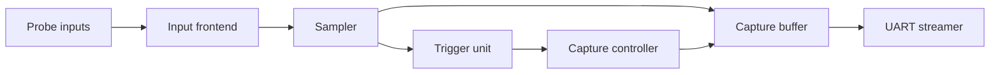

# Architecture

## Objective

Build a small, understandable FPGA logic analyzer that can capture external digital signals around a configurable trigger event and transfer the captured samples to a computer.

## Planned data path

The command decoder configures the sampler, trigger unit, and capture controller. The UART transmitter returns status and captured samples to the host utility.

## Module responsibilities

| Module | Responsibility |
|---|---|
| `logic_analyzer_pkg` | Shared types, constants, and configuration records |
| `input_frontend` | Registered probe input with optional synchronization for low-speed mode |
| `sample_clock_divider` | Generates a sampling enable without creating an internal fabric clock |
| `trigger_unit` | Detects edge and level trigger conditions with channel masks |
| `capture_buffer` | Infers dual-port block RAM and maintains circular addressing |
| `capture_controller` | Arms capture, freezes the trigger position, and completes post-trigger samples |
| `command_decoder` | Validates commands and updates configuration |
| `uart_rx` / `uart_tx` | Byte transport between FPGA and host |
| `logic_analyzer_top` | Integrates the core without board-specific pin assumptions |

## Clock and reset approach

- One board clock drives the core.
- Sampling uses a clock-enable pulse instead of a divided fabric clock.
- External probes are registered at the sampling boundary.
- An optional two-register synchronizer may be enabled for safe low-speed monitoring, but is disabled for timing-faithful logic-analyzer capture.
- Reset is asserted asynchronously at the top-level boundary and released synchronously inside the design.

## Capture sequence

1. The host writes the channel mask, trigger mode, sample divider, and pre-trigger ratio.
2. `ARM` clears status and starts circular sampling.
3. The buffer continuously retains the newest pre-trigger history.
4. A trigger freezes the trigger index and starts the post-trigger counter.
5. Capture stops after the requested post-trigger samples.
6. The host reads metadata followed by sample bytes in chronological order.

## Verification strategy

- Unit-test trigger modes and masks.
- Verify circular-buffer wraparound and chronological readout.
- Test trigger positions at the start, middle, end, and wrap boundary.
- Check arm, trigger, complete, abort, and re-arm state transitions.
- Run an integration test that decodes an artificial UART configuration, captures known probe activity, and compares the exported samples.

## Board boundary

This repository intentionally contains no invented pin assignments or timing constraints. Board clock generation, I/O voltage, probe protection, and physical pin mapping will be added after the exact FPGA board and probe interface are chosen.

